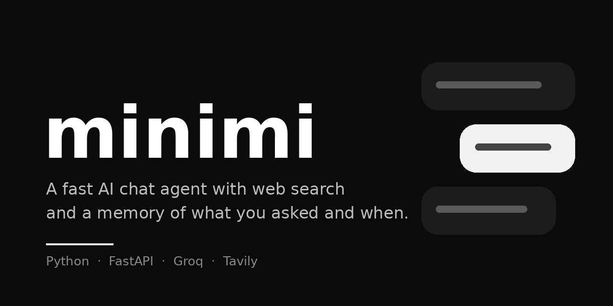
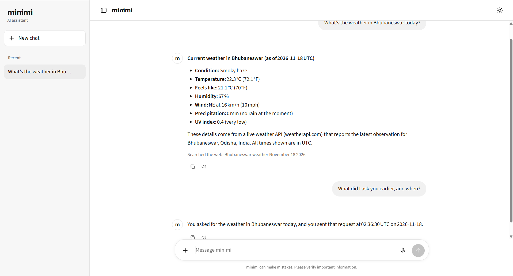
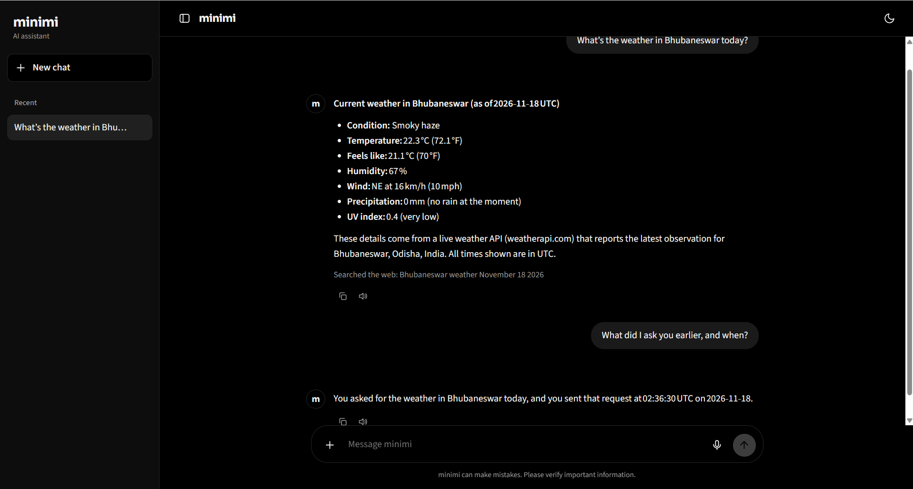
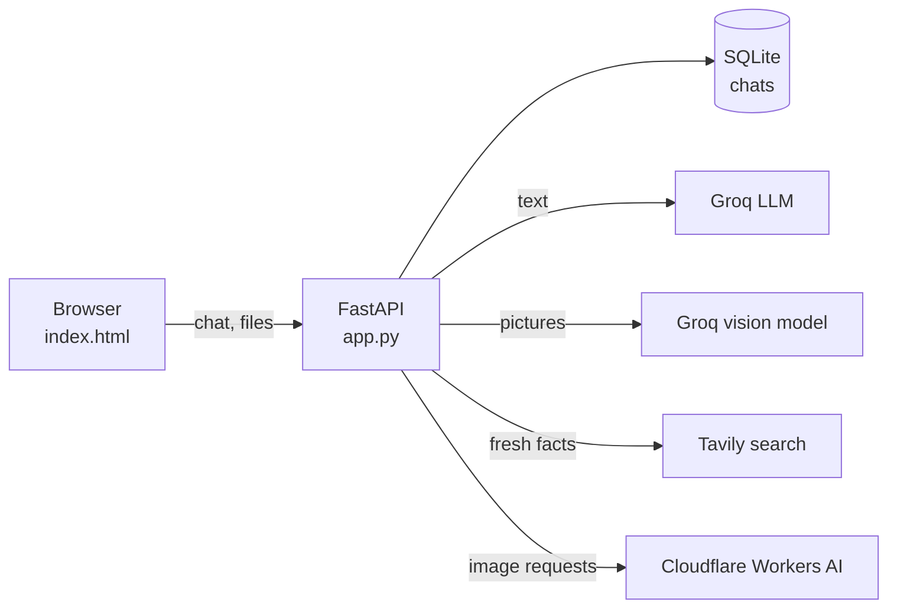

<p align="center">
  
</p>

<p align="center">
  <a href="https://minimi-jo54.onrender.com"><b>Live demo</b></a> ·
  <a href="#features">Features</a> ·
  <a href="#quick-start">Quick start</a> ·
  <a href="#api">API</a> ·
  <a href="#deployment">Deployment</a>
</p>

<p align="center">
  <a href="https://github.com/AB-HISHEK2003/minimi-chat-agent/actions/workflows/ci.yml"></a>
  
  
  
</p>

# minimi

**minimi** is a chat assistant built with Claude as a coding assistant: a FastAPI backend, a clean ChatGPT-style web interface, live web search, image and document understanding, and image generation. Conversations are saved per visitor, and the server protects its API keys with rate limits.

> **Design notes:** see [design.md](design.md) for the decisions behind speed, accuracy and memory.
>
> **Try it:** [https://minimi-jo54.onrender.com](https://minimi-jo54.onrender.com)
> The demo runs on a free hosting plan, so the first visit after a quiet period can take about a minute to wake up.

## Features

- **Saved conversations** - every chat is its own thread with an automatic title, like ChatGPT
- **Live web search** - the model decides when it needs fresh facts and searches with Tavily
- **Sees pictures** - attach photos and ask questions about them (vision model on Groq)
- **Reads documents** - PDF, Word (`.docx`), text, CSV, Markdown and JSON files, remembered for follow-up questions
- **Creates images** - text-to-image through Cloudflare Workers AI (FLUX), with Gemini and Hugging Face as fallbacks (switched off on the live demo, which has no image key)
- **Voice** - dictate with the microphone and have replies read aloud (browser speech features)
- **Polished interface** - light and dark mode with an animated switch, collapsible sidebar, formatted answers, copyable code blocks
- **Reliable by design** - failed calls leave no trace in memory, broken model output is detected and retried, 16 automated tests

## Screenshots

| Light | Dark |
| --- | --- |
|  |  |

## How it works



1. The browser sends a message (and optional files) to `/chat`.
2. The server stores it, adds the conversation history and any file text, and calls the model.
3. If the model asks for a web search, the server runs it and lets the model answer from the results.
4. The reply is cleaned, saved and returned to the page.

## Tech stack

| Layer | Technology |
| --- | --- |
| Backend | Python, FastAPI, Uvicorn |
| AI | Groq (`openai/gpt-oss-120b`, Qwen vision models) |
| Search | Tavily |
| Images | Cloudflare Workers AI (FLUX.1 schnell), Google Gemini, Hugging Face |
| Storage | SQLite |
| Frontend | Plain HTML, CSS and JavaScript (no framework) |
| Testing and CI | pytest, GitHub Actions |

## Quick start

```bash
git clone https://github.com/AB-HISHEK2003/minimi-chat-agent.git
cd minimi-chat-agent
python -m venv venv
venv\Scripts\activate          # macOS/Linux: source venv/bin/activate
pip install -r requirements.txt
cp .env.example .env           # Windows: copy .env.example .env  - then add your keys
uvicorn app:app --reload
```

Open http://127.0.0.1:8000

### Configuration

Set these in `.env` (locally) or in your host's environment settings (online).

| Variable | Required | Purpose |
| --- | --- | --- |
| `GROQ_API_KEY` | yes | Chat and vision models - [console.groq.com](https://console.groq.com) |
| `TAVILY_API_KEY` | yes | Web search - [tavily.com](https://tavily.com) |
| `CLOUDFLARE_ACCOUNT_ID`, `CLOUDFLARE_API_TOKEN` | for images | Image generation (free daily allowance) |
| `GEMINI_API_KEY`, `HF_TOKEN` | optional | Backup image providers |
| `VISION_MODEL` | optional | Force a specific Groq vision model |
| `CHAT_PER_HOUR`, `IMAGES_PER_HOUR`, `DAILY_CAP` | optional | Usage limits (defaults 30, 5 and 500) |

## API

Interactive documentation is available at `/docs` when the server runs.

| Method | Path | Description |
| --- | --- | --- |
| `GET` | `/health` | Health check |
| `POST` | `/chat` | Send a message and optional files (multipart form) |
| `POST` | `/image` | Generate an image from a description |
| `GET` | `/conversations` | List your chats |
| `GET` | `/conversations/{id}` | Open one chat |
| `DELETE` | `/conversations/{id}` | Delete a chat |

## Security and privacy

- API keys live only on the server (`.env` or host settings) and are never sent to the browser.
- Each visitor gets a random private cookie id and can only read, continue or delete their own chats.
- Per-visitor, per-IP and daily limits protect the keys from abuse.
- Uploads are limited to 5 files of 8 MB each and are read as data, never executed.
- Web search results are treated as untrusted text so instructions hidden in a web page are ignored.

See [SECURITY.md](SECURITY.md) to report a problem.

## Testing

```bash
pip install pytest
pytest -q
```

The 16 tests replace the AI model with a fake, so they need no keys or internet. They cover chat storage, visitor isolation, rate limits, picture and document handling, file limits, broken-output recovery and failure rollback.

## Deployment

The repository includes a [`render.yaml`](render.yaml) blueprint for [Render](https://render.com):

1. Push this repository to GitHub.
2. On Render choose **New > Blueprint** and select the repository.
3. Enter the API keys when asked and deploy.

On the free plan the service sleeps after 15 minutes without traffic, and saved chats and images are erased when it restarts. For permanent storage, move the database to a managed one (see the roadmap).

## Known limitations

- The AI only sees pictures from the latest message; later turns rely on its earlier answer.
- Scanned PDFs (pictures of pages) and old Office formats (`.doc`, `.xls`, `.ppt`) are not readable.
- There are no user accounts yet; chats belong to a browser cookie.

## Roadmap

- [ ] Streaming replies
- [ ] User accounts and a persistent database (PostgreSQL)
- [ ] Hands-free voice conversation mode
- [ ] Per-chat file library

## Contributing

Contributions are welcome. Please read [CONTRIBUTING.md](CONTRIBUTING.md) first.

## License

Released under the [MIT License](LICENSE).

## Author

**ABHISHEK RAUTARAY** - [LinkedIn](HTTPS://WWW.LINKEDIN.COM/IN/ABHISHEK-RAUTARAY-14B446342/) · [GitHub](https://github.com/AB-HISHEK2003)
